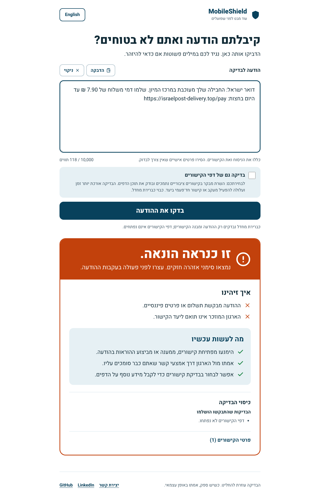
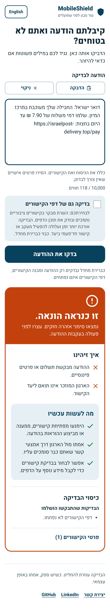
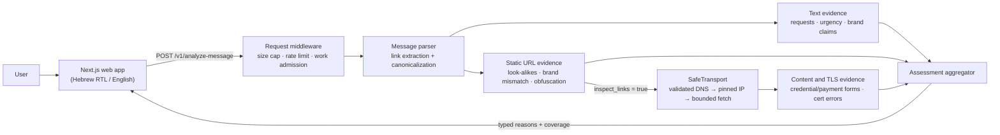

# MobileShield

**A bilingual (Hebrew/English) phishing-message checker.** Paste a suspicious SMS, WhatsApp or email message and MobileShield explains *why* it looks risky: credential or payment requests, pressure tactics, brand impersonation, look-alike domains and dangerous landing pages.


[](https://github.com/ophbra22/mobileshield/actions/workflows/ci.yml)


<p align="center">
  
  &nbsp;
  
</p>

---

## Why

Most phishing in Israel now arrives as a short text message ("your package is held", "your bank account will be blocked") rather than a web page. Existing URL scanners judge only the link and often ignore Hebrew. MobileShield analyzes the **whole message**, so the text and the link are judged together. A message that asks for your password and points to a domain that doesn't belong to the bank it names is flagged, even when the domain is brand new and on no blocklist.

## Features

- **Whole-message analysis in Hebrew and English.** Finds requests for passwords, OTP codes, card details and payments, plus urgency and account threats. It handles negation, so "never share your password" is not flagged.
- **Robust link extraction.** Extracts links from free text, including bare domains, IDN/punycode hosts, bidi control characters and trailing Hebrew punctuation. Every link is canonicalized before any check runs.
- **Brand and look-alike detection.** A single registry of 35 brands and products (global services, Israeli banks, Israel Post) holds their official domains and how they are named in English and Hebrew. It catches brand names used as hostname tokens on foreign domains (`paypal-login.example`), homoglyphs (`paypa1`, `rnicrosoft`) and swapped letters (`mircosoft`). Matching is token-based, so `purchase.com` is not "Chase" and "20% discount" is not Discount Bank.
- **Optional live page inspection.** With the user's opt-in, the server visits the link and reports credential/payment forms, page-title brand claims, redirect chains and TLS certificate problems.
- **Explainable results.** Every verdict (`phishing` / `suspicious` / `no_clear_signs` / `unknown`) comes with typed reasons, per-link evidence, recommended actions and an honest coverage status. A check that could not run is never reported as "safe".
- **Readable by anyone.** Large type, one plain-language verdict sentence, full-width controls and 44px+ touch targets, designed with older users in mind. Hebrew RTL and English LTR, keyboard navigation with a skip link, screen-reader announcements, reduced-motion and forced-colors support. Verdict colors differ in lightness as well as hue, so they stay distinguishable for color-blind users.
- **Legal and accessibility pages for an Israeli audience.** A privacy policy written for the Protection of Privacy Law (Amendment 13), a cookie and storage policy, terms of use, and an accessibility statement for IS 5568 / WCAG 2.1 AA. There are no cookies; a non-blocking notice asks before the language choice is saved on the device.
- **Privacy by design.** No database dependency on the scan path, nothing is stored, responses are `Cache-Control: no-store` and request logs contain only route, status, duration and a random request ID.

## Security engineering highlights

Fetching user-supplied URLs on a server is an SSRF risk. The link inspector (`app/detection/safe_transport.py`, `network_policy.py`) was built to fail closed:

| Threat | Mitigation |
| --- | --- |
| SSRF to internal networks / cloud metadata | Every DNS answer is validated as a public address (private, loopback, link-local, reserved, multicast, NAT64/6to4/Teredo and IPv4-mapped ranges are rejected) |
| DNS rebinding | The socket connects to the **already-validated IP** with the original `Host`/SNI; validation is repeated on **every redirect hop** |
| Obfuscated hosts (`0x7f.1`, `2130706433`, `user@host`) | Rejected before resolution; non-default ports and internal TLDs (`.local`, `.internal`…) are blocked |
| Slow-loris / header dribbling | An absolute per-request deadline enforced by a watchdog that shuts the socket down mid-read |
| Resolver hangs | `getaddrinfo` runs in a disposable child process that is killed at the deadline |
| Resource exhaustion | 128 KB request cap (counted on received bytes), 256 KB response cap, max 5 redirects, bounded concurrency, per-client rate limiting |
| Information leakage | Exception text, URLs and validation details are never echoed or logged; strict security headers and CSP |

## Architecture



## API example

```bash
curl -s -X POST http://localhost:8000/v1/analyze-message \
  -H 'Content-Type: application/json' \
  -d '{"text": "Your PayPal account will be suspended. Log in now to confirm your password: https://paypa1-secure.top/verify", "inspect_links": false}'
```

```jsonc
{
  "assessment": "phishing",
  "analysis_status": "complete",
  "reasons": [
    { "code": "credential_request", "strength": "strong", "source": "message" },
    { "code": "urgency", "strength": "strong", "source": "message" },
    { "code": "brand_destination_mismatch", "strength": "strong", "source": "message", "params": { "brand": "paypal" } },
    { "code": "lookalike_host", "strength": "strong", "source": "url", "params": { "display_host": "paypa1-secure.top" } }
  ],
  "recommended_actions": ["avoid_interaction", "verify_independently", "do_not_share_secrets", "consider_link_inspection"],
  "limitations": ["inspection_disabled"],
  "links": [ { "link_id": "link_1", "assessment": "phishing", "inspection_status": "not_requested", "...": "..." } ],
  "schema_version": 1,
  "request_id": "3f9c2a7e…"
}
```

(The response is shortened here.) The full contract is in [`docs/api.md`](docs/api.md) and the design in [`docs/architecture.md`](docs/architecture.md). Interactive docs are served at `/docs` when the API is running.

| Endpoint | Description |
| --- | --- |
| `POST /v1/analyze-message` | Analyze a message (`text` up to 10,000 characters, up to 10 links) |
| `POST /v1/analyze` | Legacy single-URL adapter (kept for older clients) |
| `GET /health`, `GET /readyz` | Liveness and database readiness probes |

## Tech stack

- **Backend:** Python 3.11, FastAPI, Pydantic v2 (strict contracts), SQLAlchemy 2, PostgreSQL, `tldextract`, `idna`
- **Frontend:** Next.js 15 (App Router), React 19, TypeScript, plain CSS with a self-hosted Heebo font (no third-party requests)
- **Testing:** pytest (849 hermetic tests that make no network or DNS calls), Vitest + Testing Library (130 tests), Playwright cross-browser tests on Chromium, Firefox and WebKit at phone, tablet and desktop sizes, axe-core WCAG 2.1 AA checks on every page, Ruff
- **Infrastructure:** Docker, Docker Compose, GitHub Actions (tests, lint, type checks, build, cross-browser runs with screenshots, and dependency audits)

## Getting started

### Docker Compose (everything)

```bash
git clone https://github.com/ophbra22/mobileshield.git
cd mobileshield
cp .env.example .env
docker compose up --build
```

- Web app: http://localhost:3000
- API + Swagger UI: http://localhost:8000/docs

### Local development

**Backend.** Message analysis needs no database. SQLite is enough locally (PostgreSQL is used in Docker):

```bash
python3.11 -m venv .venv && source .venv/bin/activate
pip install -r requirements-dev.txt
export DATABASE_URL=sqlite:///./mobileshield.db
uvicorn app.main:app --reload --port 8000
```

To demo the UI without contacting any real site, run the synthetic fixture server instead. It simulates hosts such as `paypal-login.attacker.example`:

```bash
DATABASE_URL=sqlite:// uvicorn tests.fixture_server:app --port 8000
```

**Frontend:**

```bash
cd mobileshield-web
npm ci
NEXT_PUBLIC_API_BASE_URL=http://localhost:8000 npm run dev
```

### Running the tests

```bash
# Backend: hermetic, no database or network needed
pytest
ruff check app tests

# Frontend
cd mobileshield-web
npm test            # Vitest
npm run typecheck   # tsc --noEmit
npm run lint

# Cross-browser (Chromium, Firefox, WebKit; phone, tablet and desktop)
npx playwright install chromium firefox webkit
NEXT_PUBLIC_API_BASE_URL=http://127.0.0.1:8100 npm run build
npm run e2e
```

## Project structure

```
app/
├── main.py                 # FastAPI app, security headers, error handling
├── scan_limits.py          # ASGI middleware: body cap, rate limit, admission, redacted logs
├── message_parser.py       # Link extraction & canonicalization from free text
├── message_models.py       # Strict request/response contracts (schema v1)
├── text_coverage.py        # Hebrew/English text-coverage heuristics
├── analysis.py             # Orchestrates parsing, evidence and optional inspection
├── brand.py                # Brand registry: official domains, claims, look-alikes
├── detection/
│   ├── message_analyzer.py # Text evidence + final assessment aggregation
│   ├── engine.py           # Per-link evidence collection
│   ├── safe_transport.py   # SSRF-hardened HTTP/TLS inspector
│   ├── network_policy.py   # URL authorization & isolated DNS resolution
│   └── content_analyzer.py # HTML form / title evidence
├── routers/                # HTTP routes (analysis; auth/keys are not mounted)
└── db/                     # SQLAlchemy models & session (admin/API keys only)
mobileshield-web/           # Next.js frontend
tests/                      # pytest suite + fixtures (labelled URL and message datasets)
docs/                       # API contract, architecture, screenshots
```

## Limitations

MobileShield is a heuristic decision aid, **not a safety guarantee**. Detection relies on rules, a curated brand registry and a small local blocklist rather than live threat-intelligence feeds, so new or subtle attacks can be missed. Rate limiting is per process. Production needs a proxy that passes the real client IP, and several workers need a shared store such as Redis. User accounts and API-key routes are implemented but not mounted in the public beta. See [deployment notes](docs/architecture.md#deployment-notes).

## License

[MIT](LICENSE)

## Author

**Ophir Braude** · [LinkedIn](https://www.linkedin.com/in/ophir-braude-188252378/)
