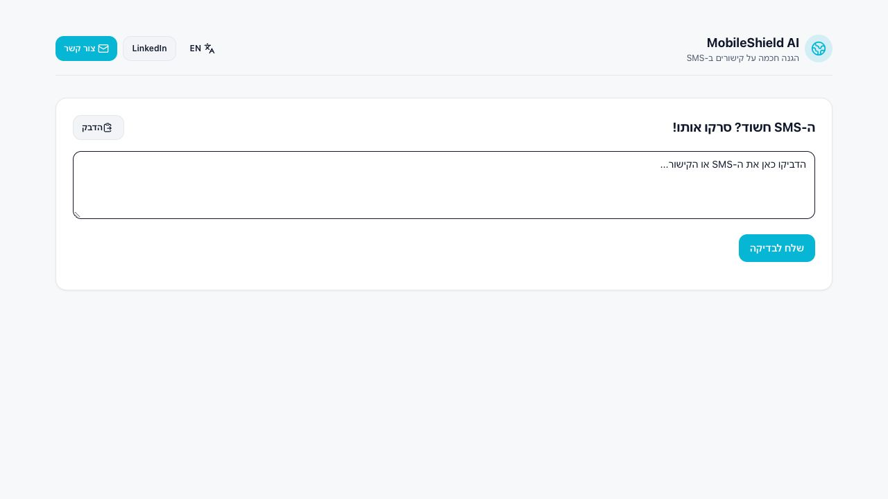
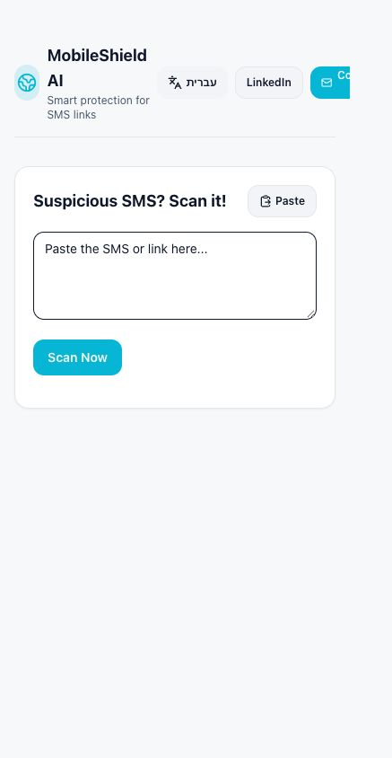
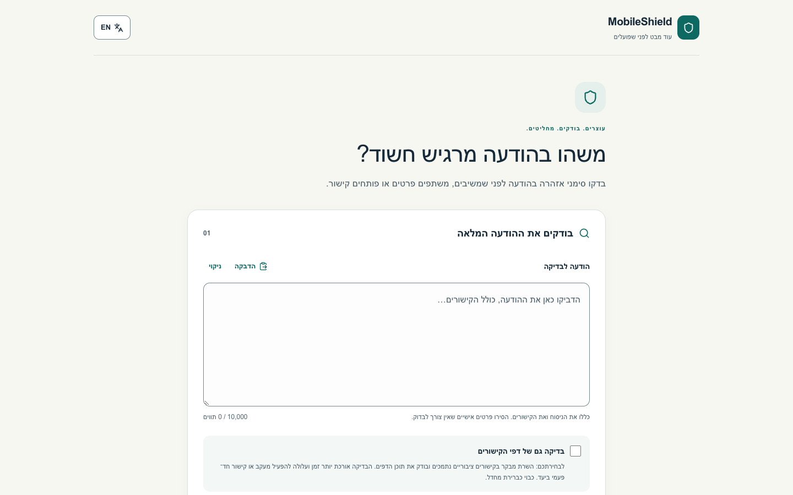
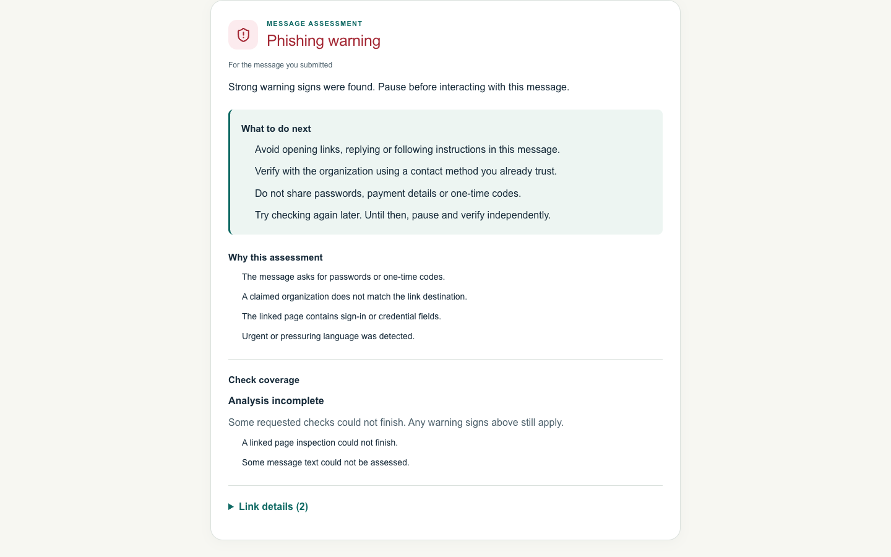
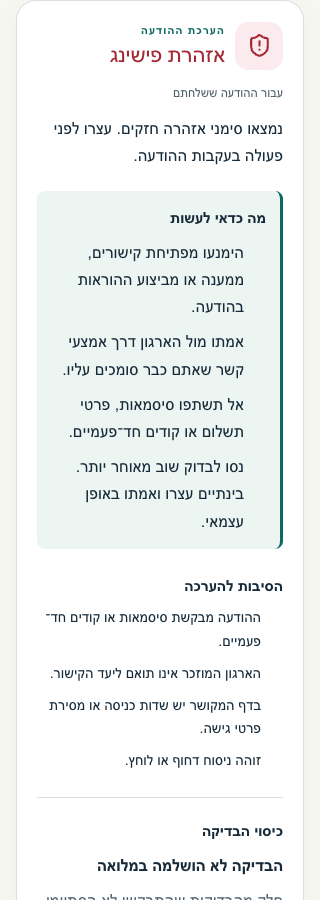
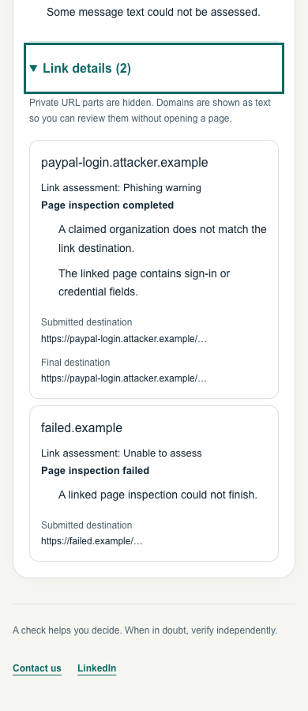
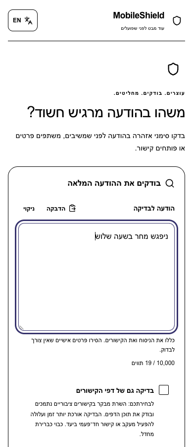
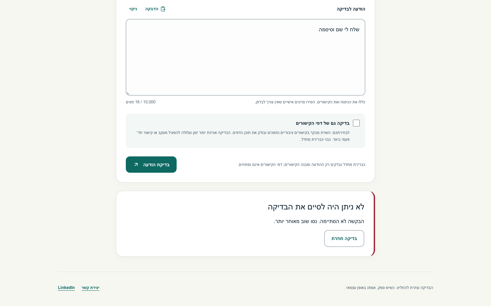

# Final browser evidence — 8 October 2026

UI/source revision: `8b5176a2b214db8760d06e3c05cb649a6c74f504`. Next 15.5.27 production build, isolated Chrome 154.0.8037.98, synthetic fixture API on loopback. No real private messages or destination-network requests.

The final run passed 12 checks and captured 35 unedited viewport screenshots across HE/EN at 320, 390, 768 and 1440 px. Assertions cover fresh hydration, exact full-message requests, input direction, unique displayed reasons, partial/error/ordinary/warning/unknown states, keyboard detail controls, masked non-clickable URLs, cancellation, input-edit invalidation, reduced-motion and forced-colors emulation, storage containing only the language preference, and old/new contract mismatch refusal. No page errors or attempted external requests were recorded.

A new frontend against a controlled404 displays an error with no assessment. An actual browser Origin-bearing legacy request receives 409 `client_upgrade_required`, `Cache-Control: no-store` and no verdict. The baseline adapter tests separately prove that this error never reaches its BENIGN mapper.

A separate focused real-browser check also passes 16 direction/value assertions: empty, whitespace-only, Hebrew-first mixed text and English-first mixed text, both UI languages, at 320 px and 1440 px. Language switching preserves the exact controlled value and real text keeps automatic direction.

After the backend-only dependency/CSP commit `c143e1756d99922d5a1be91fd6e64920091df388`, a focused browser smoke also passes: a Hebrew credential request remains suspicious, ordinary Hebrew returns no clear signs, both responses are no-store, exact static payloads are preserved, and the legacy browser request still returns 409 before a verdict. No destination network requests were made.

These are local synthetic checks. Native 200% zoom, spoken screen-reader output, Safari/Firefox, real malicious sites, production Postgres startup, proxy identity and infrastructure log retention were not tested. Browser media emulation is not an OS accessibility audit. The bounded language rules can return uncertainty for ordinary unfamiliar English words.

The first final run stopped at a QA-harness native Fetch `status()` mistake after 33 captures. Corrected only the external harness, then reran successfully. The failed report remains locally for provenance. Earlier intermediate screenshots do not validate this revision.

## Original live UI captured before implementation

## Selected final unedited captures

## Capture integrity

| File | SHA256 |
|---|---|
| mobileshield-en-320-input.png | `3dc337e7b3091bb168e21e1efef42c7442b57d24ef463cdd287eead9dcfa2360` |
| mobileshield-en-320-partial.png | `6bb5e0660146566f8b2dc7a92e87a1648ab738b587804e5ccba9671a447e2dd9` |
| mobileshield-en-320-error.png | `591f83fa03f6c044bf91077a24bd5d51262376c3fa61d2fdd6e54af0a1b971d9` |
| mobileshield-en-390-input.png | `873e12054ef9c1e9ebec7dc0d77aac90efebca9e6193d9d33b3fbcc18e06736a` |
| mobileshield-en-390-partial.png | `421ec4d071f01ef7478328088e450279080a0ce90dc0bfb55879eb02126c7132` |
| mobileshield-en-390-evidence.png | `b585a43cecf6edfb9afb9d8629f43b436f661551ef41f3f68141d7831f8d94a9` |
| mobileshield-en-390-error.png | `960fa75928e7822ca0b26ccfc14f3efa507e0ec9cee8d2232ccb9b9115eb6b56` |
| mobileshield-en-768-input.png | `e37e042e5251d303fd6a5f6d353d85962d0177976c39277e2afdeeb6dbd5632a` |
| mobileshield-en-768-partial.png | `65489709510db6b1fe91b021ca927a73165ba0ae5170333cb153b313ef884ccb` |
| mobileshield-en-768-error.png | `74cc0ba1753e77a7c36fa438aa0c89ebaf9534914ad00b24918a80df725b8a21` |
| mobileshield-en-1440-input.png | `9a856455a816b4079e9587dcc41d794b6f1ba58f65e21be923b305b45d3e30c8` |
| mobileshield-en-1440-partial.png | `e0501c9f5233f2de6da88fd1041d849626d8cd60788bf21a7482ad84ebdbfb20` |
| mobileshield-en-1440-error.png | `fe9b3f4e40f29ca66549b61bad9608d799bdbb6c9c81186d838d1ce0a406ffb1` |
| mobileshield-en-1440-ordinary.png | `a0c46b83df23cbe4afc144cdbf07ad00c1f68a2838e30834b4fe7ddca5961217` |
| mobileshield-en-1440-warning.png | `b741bc5dcd879dab92a24bf38d4989e154f48d873ebb61bbc1c7a8c88e2018e5` |
| mobileshield-en-1440-unknown.png | `a6d850326cdb3cc58074ad6787b43f33cfe0b0339ef78c84ce5196ac7ed6f059` |
| mobileshield-he-320-input.png | `fb6aec52e48134f884062fad84e0f983db2f6228f8b2c1caeeafcf3aa1f1be6e` |
| mobileshield-he-320-partial.png | `4aaec5974c26fd7f505ab6a94a64efe6f6a9ca508a2a4de06f17d3d36fb374ed` |
| mobileshield-he-320-error.png | `bdfdd6b4719bf10db89c38be23cdebceabe49d92a3ba2aa0ad999218cc30e37b` |
| mobileshield-he-390-input.png | `43c31717b8333a45819c9594a7337a9509598544ee0fec385097e5d57c04a130` |
| mobileshield-he-390-partial.png | `3c8a59212e7320e450aaef23b1ed96ce66846e3ad7068c6deaa3d08bafc1cf8b` |
| mobileshield-he-390-evidence.png | `e4267986860fc3647b298fbbeb462b06b8db6c78ae5ec0bbee489a4704326e2d` |
| mobileshield-he-390-error.png | `cf6a93e2bf76dce5cdbc58323c944564cd78ae1f1cff10aec188f1a6efaa7293` |
| mobileshield-he-768-input.png | `fe7c3d6980d543374ff3d6472b9694fe7ba083b1cbccee4df0c41828a0673e00` |
| mobileshield-he-768-partial.png | `a8338415a89336968bdf31cef0db432edfd12eb01fd50f84aea94bdae969e123` |
| mobileshield-he-768-error.png | `767c7008327d73b2a536e2b2d7be1c800671e6a5256d28b34cc88fbf041a157a` |
| mobileshield-he-1440-input.png | `af40db9773df74840050a069683ae08d1e187ba66db55e39456947ef93a75aea` |
| mobileshield-he-1440-partial.png | `7d26960a6ba77d607483ebcc34b703d1ecf7d741a92d2d6cf2bc93070ee3d4b6` |
| mobileshield-he-1440-error.png | `bc869f2ab5b17a50a621a1585fedbaa73cfb9743ecf0840cb7253f5de34c39ab` |
| mobileshield-he-1440-ordinary.png | `b3c40960c7219392f14f87d3773713504a69745b173740530b768fdd6610a5c7` |
| mobileshield-he-1440-warning.png | `60a824c6b438d98101a47eedea151f250fe6236e4b07fad4661e2a53dc774d11` |
| mobileshield-he-1440-unknown.png | `8e80676b8c43dd6f5e1c748df31eb44b76774b62bb872d3c85cef48f63e10e46` |
| mobileshield-he-1440-server-mismatch.png | `c1c7224f9d3f7793204902783bc9b7d10e345b9d9d5e6a5d7ad7416ede4b00b0` |
| mobileshield-he-390-reduced-motion.png | `639e102a59b5313b9e47533f837011891546741b40a504f0eb1f5857290c87ba` |
| mobileshield-he-390-forced-colors.png | `f8ddaa94f65169e78d5a34f8af229a47afeaf3eefef1ac27be9cf45f43d33c83` |
